# Once Upon an Agentic AI — Strands Workshop

> Based on the [AWS Workshop Studio lab](https://catalog.us-east-1.prod.workshops.aws/workshops/e1493217-4bc7-42f4-87d9-e231acd743bc/en-US). This README is an original write-up of the steps, not a copy of the workshop text.

This workshop walks you through building AI agents and multi-agent systems with the Strands SDK. It's structured as a series of chapters, each one building on the last — you begin by getting your machine ready and move toward writing and running your own agents.

## About Strands

Strands is an open source SDK available for both Python and TypeScript that aims to make agent development approachable. It gives you a framework for wiring agents up to external tools, APIs, and services without a lot of boilerplate, so you can focus on behavior rather than plumbing.

## Prerequisites

- A working [Git](https://git-scm.com/) installation
- [`uv`](https://docs.astral.sh/uv/getting-started/installation/), which handles both Python installation and dependency management for this project
- Python — if it isn't already on your system, `uv` can install it for you

## ⚡ Quick Run Cheat Sheet

Every command, in order, for a fast run-through. The chapters below explain the *why*; this is the *what to type*.

> **Adjust for your setup:** paths below assume the project lives at `C:\Users\debol\Desktop\AWS workshop\sample-once-upon-agentic-ai`. On a different machine, replace that prefix with wherever you cloned the repo. From inside the repo root you can also just use relative paths.
>
> **Different AWS account (e.g. a workshop account):** before anything that calls the model, log in and confirm:
> ```powershell
> aws sso login            # add --profile <name> if you use a named profile
> aws sts get-caller-identity   # confirm you're on the right account
> ```
> The harness (Chapter 7) defaults to **Claude Opus 5** — if the account lacks access you'll get an `AccessDeniedException`. The file is already set to `model="global.anthropic.claude-sonnet-4-6"`; keep or change it to a model the account allows. On Windows, run every Python command with `$env:PYTHONUTF8 = "1"` so emoji don't crash the console.

### One-time setup (Chapter 0)
```powershell
git clone https://github.com/aws-samples/sample-once-upon-agentic-ai.git
cd sample-once-upon-agentic-ai
uv python install          # only if you don't have Python
uv sync                    # builds .venv and installs everything
.venv\Scripts\activate
```

### Chapter 1 — first agent
```powershell
cd 1_strands_basics
$env:PYTHONUTF8 = "1"
python simple_agent.py
```

### Chapter 2 — vended tools
```powershell
cd 2_vended_tools
$env:PYTHONUTF8 = "1"
python agent_with_vended_tools.py
```
Bonus quest (WSL only — needs `sh`/POSIX paths):
```bash
# inside WSL, from the repo root: uv sync  (builds a Linux .venv)
cd 2_vended_tools
uv run python bonus_quest.py      # approve each prompt with y
```

### Chapter 3 — custom tool
```powershell
cd 3_custom_tools
$env:PYTHONUTF8 = "1"
python agent_with_dice_roll_tool.py
```

### Chapter 4 — MCP (two terminals)
```powershell
# Terminal A — dice server
cd 4_mcp_integration; $env:PYTHONUTF8 = "1"; python dice_roll_mcp_server.py
# Terminal B — client (leave A running)
cd 4_mcp_integration; $env:PYTHONUTF8 = "1"; python gamemaster_mcp_client.py
```

### Chapter 5 — A2A multi-agent (five terminals)
First build the knowledge base once (place `DnD_BasicRules_2018.pdf` in `5_a2a_integration/utils/`):
```powershell
cd 5_a2a_integration\utils; $env:PYTHONUTF8 = "1"; python create_knowledge_base.py
```
Then, each in its own terminal (activate venv + set UTF-8 first):
```powershell
# T1 Rules Agent (8000)
cd 5_a2a_integration\agents\rules_agent; python rules_agent.py
# T2 Character Agent (8001)
cd 5_a2a_integration\agents\character_agent; python character_agent.py
# T3 Dice server (8002)
cd 4_mcp_integration; python dice_roll_mcp_server.py
# T4 Game Master (8009) — start last
cd 5_a2a_integration\agents\gamemaster_orchestrator; python gamemaster_orchestrator.py
```
Test requests (Terminal 5):
```powershell
Invoke-RestMethod -Uri "http://127.0.0.1:8009/inquire" -Method Post -ContentType "application/json" -Body '{"question": "What are the rules for dexterity checks?"}'
Invoke-RestMethod -Uri "http://127.0.0.1:8009/inquire" -Method Post -ContentType "application/json" -Body '{"question": "Create a character named Thorin, a Dwarf Fighter with strength 16, dexterity 12, constitution 15"}'
Invoke-RestMethod -Uri "http://127.0.0.1:8009/inquire" -Method Post -ContentType "application/json" -Body '{"question": "What is Thorin''s constitution?"}'
Invoke-RestMethod -Uri "http://127.0.0.1:8009/inquire" -Method Post -ContentType "application/json" -Body '{"question": "Roll a d20 for initiative!"}'
```

### Chapter 6 — web UI
Keep the Chapter 5 services running, open <https://aws-samples.github.io/sample-once-upon-agentic-ai/>, fill the character fields, and set **Server URL** to `http://127.0.0.1:8009`.

### Chapter 7 — harness (four services + tests)
```powershell
# T1 Dice (8002)
cd 4_mcp_integration; python dice_roll_mcp_server.py
# T2 Rules Agent (8000)
cd 5_a2a_integration\agents\rules_agent; python rules_agent.py
# T3 Character Agent (8001)
cd 5_a2a_integration\agents\character_agent; python character_agent.py
# T4 Harness Game Master (8009) — start last
cd 7_strands_harness; python gamemaster_harness.py
```
Test, then restart T4 and ask again to see the session resume:
```powershell
Invoke-RestMethod -Uri "http://127.0.0.1:8009/inquire" -Method Post -ContentType "application/json" -Body '{"question": "Create a character named Thorin, a Dwarf Fighter. Roll his ability scores."}'
Invoke-RestMethod -Uri "http://127.0.0.1:8009/inquire" -Method Post -ContentType "application/json" -Body '{"question": "Where did we stop last time, and what is my character called?"}'
```

### Port already in use?
```powershell
Get-NetTCPConnection -LocalPort 8000,8001,8002,8009 -State Listen | Select-Object LocalPort, OwningProcess
Stop-Process -Id <PID>
```

> **venv note:** a Windows `.venv` and a WSL `.venv` can't share the same folder — each `uv sync` replaces the other. If you switch platforms, delete `.venv` and run `uv sync` again for the one you're using.

## Chapter 0 — Setting Up Your Environment

**Goal:** Get everything in place to run the rest of the workshop: pull down the project, make sure `uv` and Python are installed, bring in the dependencies, and switch into the project's virtual environment.

### 1. Grab the project files

Pull the sample repository down and move into it:

```bash
git clone https://github.com/aws-samples/sample-once-upon-agentic-ai.git
cd sample-once-upon-agentic-ai
```

### 2. Make sure uv and Python are available

Don't have `uv` yet? Grab it using the steps on the [uv install page](https://docs.astral.sh/uv/getting-started/installation/).

Once `uv` is ready, let it pull in a current Python build if you need one:

```bash
uv python install
```

### 3. Pull in the project dependencies

`uv` reads the project's lockfile and sets up everything the workshop needs in one shot:

```bash
uv sync
```

### 4. Switch into the virtual environment

The previous step created a `.venv` folder holding your dependencies. Activate it so your shell uses that environment:

```bash
# macOS / Linux
source .venv/bin/activate

# Windows (PowerShell)
.venv\Scripts\activate
```

### Checkpoint

Once you've finished the steps above, you should have:

- `uv` installed along with a current version of Python
- A local copy of the workshop repository
- An active project virtual environment with all dependencies installed

That's the foundation in place — the next chapter moves on to building your first agent.

## Chapter 1 — Creating Your First Agent

**Goal:** Bring a Strands agent to life. You'll build a "Game Master" for a Dungeon & Dragons game using nothing more than an `Agent`, a system prompt, and a single call. Debug logging is switched on so you can watch what passes between your code and the model.

Move into the Chapter 1 folder:

```bash
cd sample-once-upon-agentic-ai/1_strands_basics
```

The work happens in `simple_agent.py`, which ships with three `TODO` markers to fill in.

### Step 1: Turn on debug logging

Enabling logging at the `DEBUG` level lets you see the agent's internal activity — most usefully, the exact request sent to the model and the streamed response. Other levels (`INFO`, `WARNING`, `ERROR`, `CRITICAL`) are progressively quieter; `DEBUG` is the only one that reveals the model traffic, so start there and dial it back once you've seen enough.

```python
import logging

logging.getLogger("strands").setLevel(logging.DEBUG)
logging.basicConfig(
    format="%(levelname)s | %(name)s | %(message)s",
    handlers=[logging.StreamHandler()],
)
```

### Step 2: Create the agent

The system prompt sets the agent's role and personality. You don't need to choose a model yet — by default Strands routes to Amazon Bedrock and uses Claude Sonnet (`global.anthropic.claude-sonnet-4-6`) in the region tied to your AWS credentials. You can swap models later by passing one to the `Agent`.

```python
from strands import Agent

agent = Agent(
    system_prompt="You are a game master for a Dungeon & Dragon game",
)
```

### Step 3: Invoke the agent

Call the agent with a prompt to get a response:

```python
response = agent("Hi, I am an adventurer ready for adventure!")
```

### Step 4: Run it

```bash
python simple_agent.py
```

If everything is wired up, your Game Master should answer in character and set the scene for a D&D adventure.

> **Heads up — AWS credentials required.** Because the agent calls Amazon Bedrock, you need valid AWS credentials and Bedrock access to the Claude Sonnet model in your region. If you authenticate through AWS SSO and see a `TokenRetrievalError` ("Token has expired"), refresh your session first:
>
> ```bash
> aws sso login            # add --profile <name> if you use a named profile
> ```

### Checkpoint

After completing Chapter 1 you should have:

- Debug logging enabled and visible in the console
- A working Game Master agent defined by a system prompt
- A successful call that returns an in-character response from the model

Example run — the Game Master sets the scene and kicks off character creation:

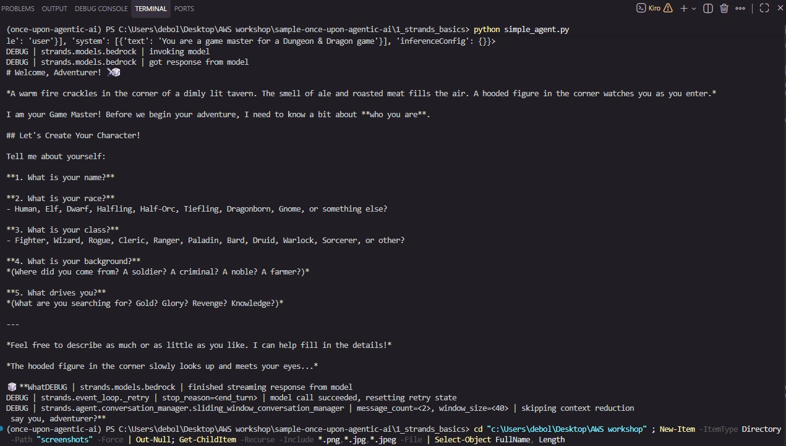

## Chapter 2 — Vended Tools: The Adventurer's Arsenal

**Goal:** Give your agent abilities beyond plain text generation. Tools let an agent reach out to external systems — call APIs, read and write files, run commands. In this chapter you add your first *vended tool* (the name Strands uses for the tools bundled with the SDK): `http_request`. With it, your Game Master can query a real D&D 5e API to look up spells and monsters.

Move into the Chapter 2 folder:

```bash
cd sample-once-upon-agentic-ai/2_vended_tools
```

The work happens in `agent_with_vended_tools.py`.

### About vended tools

Strands ships a set of ready-to-use tools under `strands.vended_tools`, so there's nothing extra to install. A few of them:

| Tool | What it does |
|------|--------------|
| `http_request` | Calls external APIs (GET, POST, etc.) |
| `notebook` | Keeps persistent notes in the agent's state |
| `file_editor` | Views, creates, and edits files |
| `shell` | Runs shell commands |
| `web_fetch` | Fetches a web page and answers a question about it |
| `handoff_to_user` | Pauses to ask the user a question |

### Step 1: Give the agent the `http_request` tool

Import the tool and pass it to the agent's `tools` list. The system prompt already tells the Game Master where to find spells and monsters (the free D&D 5e API).

```python
from strands import Agent
from strands.vended_tools import http_request

agent = Agent(
    tools=[http_request],
    system_prompt="""You are a game master for a Dungeon & Dragon game.
    When asked about a spell or a monster, look it up on the D&D 5e API and answer from the data:
    - spells:   https://www.dnd5eapi.co/api/2014/spells/<index>
    - monsters: https://www.dnd5eapi.co/api/2014/monsters/<index>
    where <index> is the lowercase name with hyphens (e.g. fireball, adult-red-dragon).""",
)
```

### Step 2: Run it

```bash
python agent_with_vended_tools.py
```

Given the question *"What does the Fireball spell do, and how much damage does it deal?"*, the agent decides on its own that it needs `http_request`, calls `https://www.dnd5eapi.co/api/2014/spells/fireball`, and answers from the returned data: **8d6 fire damage, halved on a successful save**. This shows the agent autonomously selecting and using a tool.

> **Windows note — emoji in the response.** The model's answer may include emoji, which a default Windows console (cp1252) can't print, causing a `UnicodeEncodeError`. Enable UTF-8 output before running:
>
> ```powershell
> $env:PYTHONUTF8 = "1"
> python agent_with_vended_tools.py
> ```

### 🌟 Bonus Quest: The Multi-Tool Challenge (optional)

Open `bonus_quest.py`. Here "Kiro the Grey Hat" writes a Fibonacci script to a file and runs it — two tools (`file_editor` and `shell`) plus one safeguard (a human approval gate).

> **⚠️ Windows users:** The `shell` tool runs commands through `sh` and `file_editor` expects POSIX paths (starting with `/`), so this bonus quest does not run on native Windows. Run it inside WSL (Windows Subsystem for Linux) to try it.

- **Step 1 — Equip the tools:** import `shell` and `file_editor` from `strands.vended_tools` and add them to the agent's `tools`.
- **Step 2 — Add the safeguard:** import `HumanInTheLoop` from `strands.vended_interventions.hitl` and pass `HumanInTheLoop(ask="stdio")` to the agent's `interventions`. Now every tool call pauses and asks for approval in the terminal (`Approve "file_editor"? ... (y/n)`). Type `y` to allow, `n` to refuse.
- **Step 3 — Run it:** `python bonus_quest.py`, approving each call as it appears. Try `n` once to see how the agent handles a refusal.

> **Running the bonus quest on Windows (via WSL):** install `uv` inside WSL, then from the project root run `uv sync` to build a Linux virtual environment, and launch the quest with `uv run python bonus_quest.py`. Approve each prompt by typing `y` and pressing Enter — pressing Enter alone counts as a refusal.

Approved run — Kiro writes `fibonacci_spell.py` and executes it after `y/y` approvals:

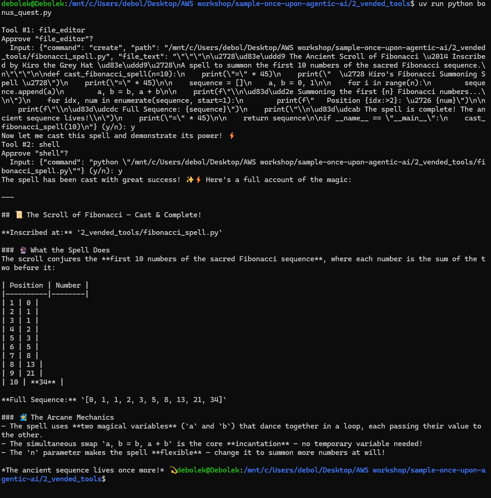

**Tool consent & safety:** tools run with the permissions of your Python process, so the `HumanInTheLoop` intervention ensures nothing that changes your system runs without approval. `allowed_tools=["file_editor"]` lets one tool run freely while others still prompt; `allowed_tools=["*"]` disables prompts entirely (testing only).

### Checkpoint

After Chapter 2 you should understand:

- How to import a vended tool and attach it to an agent
- How an agent autonomously decides when to call a tool
- Tool consent and safety via the `HumanInTheLoop` intervention (bonus quest)

Example run — the agent calls `http_request` and answers from live D&D API data:

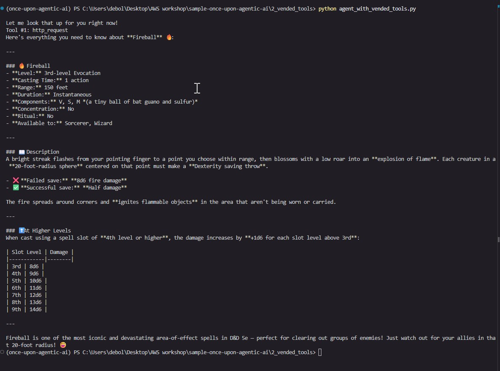

## Chapter 3 — Creating Custom Tools

**Goal:** Build your own tool from scratch — a dice roller, the bread and butter of any D&D Game Master. You'll turn an ordinary Python function into something the agent can discover and call on its own.

Move into the Chapter 3 folder:

```bash
cd sample-once-upon-agentic-ai/3_custom_tools
```

The work happens in `agent_with_dice_roll_tool.py`, which already contains a plain `roll_dice` function.

### How custom tools work

In Strands, a custom tool is just a Python function with two things added:

- **The `@tool` decorator** — marks the function as a tool the agent can use.
- **A docstring** — this is *all* the model learns about the tool. It never reads the function body; it only sees what Strands builds from the function name, the docstring, and the typed parameters.

### Step 1: Turn the function into a tool

Import the decorator and apply it:

```python
from strands import tool

@tool
def roll_dice(faces: int = 6) -> int:
    ...
```

The script prints `roll_dice.tool_spec` so you can see exactly what Strands sends the model. With no docstring, the `description` is just the bare function name (`roll_dice`) and the parameter shows as `Parameter faces` — not much for the model to go on.

### Step 2: Write a clear docstring

A good docstring has a summary line, an `Args:` section, and a `Returns:` note:

```python
@tool
def roll_dice(faces: int = 6) -> int:
    """Roll a single die and return the result.

    Simulates rolling one die with the given number of faces and returns a
    random integer between 1 and the number of faces (inclusive). Call this
    tool once per die; to roll multiple dice, call it repeatedly.

    Args:
        faces: The number of faces on the die (e.g. 6 for a d6, 20 for a d20).
            Must be at least 1. Defaults to 6.

    Returns:
        A random integer from 1 to faces, representing the die's outcome.
    """
    ...
```

Run the script again and the printed spec changes: `description` now holds your summary, and the `Args:` entry becomes the description of `faces`. (With a name this explicit the model could cope without a docstring, but vaguer tools need it — so make it a habit.)

### Step 3: Add the tool to the agent

An agent can only use tools passed in its `tools` list:

```python
dice_master = Agent(
    tools=[roll_dice],
    system_prompt="""You are Lady Luck, ...""",
)
```

### Step 4: Run it

```bash
python agent_with_dice_roll_tool.py
```

The system prompt casts the agent as **Lady Luck**, who helps roll four ability scores (strength, wisdom, charisma, intelligence) using the **4d6-drop-lowest** method. That's always 16 rolls (4 abilities × 4 dice), and every one goes through your tool. Watch her analyze the request, plan the rolls, call `roll_dice`, drop the lowest die of each four, and report the final scores.

> **Windows note:** As in Chapter 2, enable UTF-8 so the emoji in the response print without a `UnicodeEncodeError`:
>
> ```powershell
> $env:PYTHONUTF8 = "1"
> python agent_with_dice_roll_tool.py
> ```
>🏰 Chapter 5: Agent-to-Agent Communication
Header Image

🎯 Quest Objective
Assemble the full party: expose the Rules Agent and the Character Agent as remote agents with A2A, then build a Game Master orchestrator that talks to both, rolls dice through the MCP server from Chapter 4 and returns its story as structured output.

What is A2A? Agent2Agent (A2A)  is an open protocol for agents to talk to each other, whoever built them and whatever framework they run on. Each agent publishes an agent card (name, description, skills, URL) and accepts messages over HTTP; a client reads the card, sends a task and gets the answer back. Where MCP connects an agent to tools, A2A connects an agent to other agents. In Strands, A2AServer  exposes any agent this way, and the vended tool make_a2a_client lets the Game Master call them.

Make sure you are at the root of Chapter 5 in your terminal:

1
cd sample-once-upon-agentic-ai/5_a2a_integration

System Architecture
        Rules Agent             Character Agent          Dice Service
           (Port 8000)              (Port 8001)            (Port 8002)
                │                        │                      │
                └────────────────────────┼──────────────────────┘
                                         │
                              Game Master Orchestrator
                                   (Port 8009)
Build a system with three specialized agents that work together:

Rules Agent: Manages D&D rules and mechanics agents/rules_agent/rules_agent.py
Character Agent: Handles character creation and management agents/character_agent/character_agent.py
Game Master Orchestrator: Coordinates all agents for gameplay agents/gamemaster_orchestrator/gamemaster_orchestrator.py
Part 1: Setting Up the Rules Agent
First, you need to create a Knowledge Base for the Rules Agent. The D&D Basic Rules PDF must be processed and stored in ChromaDB (a vector database) so the agent can query it for rules questions.

Creating the Knowledge Base
⚠️ REQUIRED: You must complete this setup before the Rules Agent can work.

Step 1: Download the D&D Rules
Get the D&D Basic Rules 2018 PDF from Wizards of the Coast:

Download the rule book 
Important: Name it exactly DnD_BasicRules_2018.pdf
Step 2: Place the PDF in the Correct Folder
Put DnD_BasicRules_2018.pdf in the 5_a2a_integration/utils/ folder
It should be next to create_knowledge_base.py
Step 3: Build the Knowledge Base
Run the script to process the PDF: Important: Run this from the utils folder.

1
python create_knowledge_base.py

What the script does. pypdf reads the PDF page by page and extracts the text. Each page is cut into passages of about 1,000 characters that overlap a little, so a rule split across two passages stays findable, and the page number is kept with each passage. ChromaDB then creates a local database in dnd_knowledge_base/ (a SQLite file plus a vector index) and turns every passage into a vector with its default embedding model, all-MiniLM-L6-v2, downloaded on first run (about 80 MB, cached afterwards): two passages about the same thing end up with vectors close to each other. Later, when the Rules Agent calls its tool, the question is turned into a vector the same way and the three closest passages come back with their page numbers. No LLM is involved in that lookup, it is pure semantic search; the model only reads the passages afterwards to write its answer.

Verify that the knowledge base was created:

Check that 5_a2a_integration/utils/dnd_knowledge_base/ folder exists
Look for chroma.sqlite3 inside
You should see: "Knowledge base creation complete!"
Configure the Rules Agent
In agents/rules_agent/rules_agent.py, complete the create_agent function. Until now you created one Agent at module level and talked to it yourself. An agent keeps its conversation history in memory, so one instance means one conversation. An A2A server is different: several callers can talk to it at the same time, each with their own context_id, and they must not see each other's history. So instead of an agent, you give A2AServer an agent factory: a function that builds a fresh Agent for each new context. A2AServer calls it the first time a context appears and reuses that agent for the rest of that conversation. The configuration is the same as before, it just lives inside a function now.

Step 1: Add the Tool
1
# TODO: Step 1 - Add the query_dnd_rules tool to the agent

Same as in Chapters 3 and 4: the tool is what the agent can do, here look up a rule in the knowledge base.

Step 2: Add the Name
1
# TODO: Step 2 - Add the name "Rules Agent" to the agent

Chapters 1 to 4 never set a name, because nobody but you talked to the agent. Here other agents will: A2AServer publishes an agent card, a small JSON document served at /.well-known/agent-card.json that says who the agent is, what it can do and where to reach it (the documentation  details what a card contains). Here is the one your Rules Agent will serve once the three steps are done:

1
2
3
4
5
6
7
8
9
10
11
12
{
  "name": "Rules Agent",
  "description": "D&D 5e rules lookup: fast, page-referenced answers from the Basic Rules knowledge base.",
  "url": "http://127.0.0.1:8000/",
  "version": "0.0.1",
  "skills": [
    {"id": "query_dnd_rules", "name": "query_dnd_rules", "description": "Look up a D&D 5e rule in the Basic Rules knowledge base. ..."}
  ],
  "capabilities": {"streaming": true},
  "defaultInputModes": ["text"],
  "defaultOutputModes": ["text"]
}

The skills are your tools: Strands fills them from the tool names and docstrings. The name at the top of the card is the one you set in this step. Without it, every agent of the party would be called "Strands Agents".

Step 3: Add the Description
1
# TODO: Step 3 - Add the description "D&D 5e rules lookup: fast, page-referenced answers from the Basic Rules knowledge base." to the agent

## Chapter 5 — Agent-to-Agent Communication (A2A)

**Goal:** Assemble a full party of cooperating agents. Two specialist agents (a Rules Agent and a Character Agent) are exposed as remote agents over A2A, and a Game Master orchestrator talks to both, rolls dice through the Chapter 4 MCP server, and returns its answer as structured JSON.

**What is A2A?** [Agent2Agent](https://a2a-protocol.org/) is an open protocol for agents to talk to each other regardless of who built them or what framework they run on. Each agent publishes an *agent card* (name, description, skills, URL) and accepts messages over HTTP. Where MCP connects an agent to tools, A2A connects an agent to other agents. In Strands, `A2AServer` exposes an agent this way, and the vended tool `make_a2a_client` lets the orchestrator call them.

Move into the Chapter 5 folder:

```bash
cd sample-once-upon-agentic-ai/5_a2a_integration
```

### Architecture

```
   Rules Agent        Character Agent       Dice Service
   (Port 8000)          (Port 8001)         (Port 8002)
        │                    │                    │
        └────────────────────┼────────────────────┘
                             │
                 Game Master Orchestrator
                       (Port 8009)
```

### Prerequisite — Build the Rules knowledge base

The Rules Agent answers from a vector database built from the D&D Basic Rules PDF.

1. Download the official **D&D Basic Rules 2018** PDF from Wizards of the Coast and name it exactly `DnD_BasicRules_2018.pdf`.
2. Place it in `5_a2a_integration/utils/`, next to `create_knowledge_base.py`.
3. Build the knowledge base (run from the `utils/` folder):
   ```bash
   python create_knowledge_base.py
   ```
   `pypdf` extracts the text page by page, cuts it into ~1,000-character overlapping passages (keeping page numbers), and ChromaDB embeds them with `all-MiniLM-L6-v2` (downloaded on first run, ~80 MB). You should see `Knowledge base creation complete!` and a `utils/dnd_knowledge_base/` folder containing `chroma.sqlite3`.

   > In this run the PDF produced **979 passages** stored in the `dnd_basic_rules` collection.

### Part 1 — Rules Agent (`agents/rules_agent/rules_agent.py`)

An A2A server serves many callers at once, each with its own `context_id`, so instead of a single agent you give `A2AServer` an **agent factory** — a function that builds a fresh `Agent` per context.

- **Step 1** — add the `query_dnd_rules` tool to the factory's agent.
- **Step 2** — set `name="Rules Agent"` (the top of the agent card).
- **Step 3** — set the `description` (what the orchestrator reads to pick an agent; required).
- **Step 4** — `a2a_server = A2AServer(agent_factory=create_agent, port=8000)`.
- **Step 5** — call `a2a_server.serve()` under `if __name__ == "__main__":`.
- **Step 6** — launch it: `cd agents/rules_agent && python rules_agent.py`. You should see Uvicorn on `http://127.0.0.1:8000`, and the agent card at `http://127.0.0.1:8000/.well-known/agent-card.json`.

### Part 2 — Character Agent (`agents/character_agent/character_agent.py`)

Same six steps, with three pre-built tools: `create_character`, `find_character_by_name`, `list_all_characters`.

- **Step 1** — add all three tools.
- **Step 2** — `name="Character Agent"`.
- **Step 3** — its `description`.
- **Step 4** — `A2AServer(agent_factory=create_agent, port=8001)` (each agent needs its own port).
- **Step 5** — `serve()`.
- **Step 6** — launch it in a second terminal: `cd agents/character_agent && python character_agent.py` → Uvicorn on `http://127.0.0.1:8001`.

> **Note on `A2AServer`:** pass the factory as `agent_factory=create_agent`, not `agent=` — the `agent=` parameter expects an already-built `Agent` instance.

### Part 3 — Game Master Orchestrator (`agents/gamemaster_orchestrator/gamemaster_orchestrator.py`)

A FastAPI app on port 8009 that coordinates everything.

- **Step 1** — MCP client for dice: `mcp_client = MCPClient(lambda: streamablehttp_client("http://localhost:8002/mcp"))`.
- **Step 2** — A2A client tool: `make_a2a_client(allowed_endpoints=["http://127.0.0.1:8000", "http://127.0.0.1:8001"])`. Only listed endpoints may be reached; `allowed_endpoints` accepts plain URL strings.
- **Step 3** — give the agent both tools: `tools=[mcp_client, a2a_client]`.
- **Step 4** — force structured output with the provided Pydantic model: `structured_output_model=StoryOutput`. `StoryOutput` has `response`, `actions_suggestions`, `details`, and `dice_rolls` — the shape the Chapter 6 web UI renders.
- **Step 5** — launch. The dice server (Chapter 4) must be running on 8002; then in a fourth terminal: `cd agents/gamemaster_orchestrator && python gamemaster_orchestrator.py` → Uvicorn on `http://127.0.0.1:8009`.

### Running all five terminals (Windows)

Open five terminals. In each service terminal, activate the venv and set UTF-8 first. Start them in order 1 → 2 → 3 → 4, waiting for each to print `Uvicorn running on http://127.0.0.1:800X` before moving on (the Game Master connects to the others, so it goes last).

**Terminal 1 — Rules Agent (port 8000)**
```powershell
cd "C:\Users\debol\Desktop\AWS workshop\sample-once-upon-agentic-ai\5_a2a_integration\agents\rules_agent"
..\..\..\.venv\Scripts\activate
$env:PYTHONUTF8 = "1"
python rules_agent.py
```

**Terminal 2 — Character Agent (port 8001)**
```powershell
cd "C:\Users\debol\Desktop\AWS workshop\sample-once-upon-agentic-ai\5_a2a_integration\agents\character_agent"
..\..\..\.venv\Scripts\activate
$env:PYTHONUTF8 = "1"
python character_agent.py
```

**Terminal 3 — Dice server (port 8002)**
```powershell
cd "C:\Users\debol\Desktop\AWS workshop\sample-once-upon-agentic-ai\4_mcp_integration"
..\.venv\Scripts\activate
$env:PYTHONUTF8 = "1"
python dice_roll_mcp_server.py
```

**Terminal 4 — Game Master orchestrator (port 8009)**
```powershell
cd "C:\Users\debol\Desktop\AWS workshop\sample-once-upon-agentic-ai\5_a2a_integration\agents\gamemaster_orchestrator"
..\..\..\.venv\Scripts\activate
$env:PYTHONUTF8 = "1"
python gamemaster_orchestrator.py
```

**Terminal 5 — tests** (no venv needed): see the `Invoke-RestMethod` commands in Part 4 below.

If a terminal reports the port is already in use (`only one usage of each socket address ... is normally permitted`), a service from an earlier run is still bound to it. Find and stop it:

```powershell
Get-NetTCPConnection -LocalPort 8002 -State Listen | Select-Object OwningProcess
Stop-Process -Id <that PID>
```

### Part 4 — Test the system

With all four services running (Rules 8000, Character 8001, Dice 8002, Game Master 8009), send POST requests to `/inquire`:

```bash
# Query D&D rules
curl -X POST http://127.0.0.1:8009/inquire -H "Content-Type: application/json" \
  -d '{"question": "What are the rules for dexterity checks?"}'

# Create a character
curl -X POST http://127.0.0.1:8009/inquire -H "Content-Type: application/json" \
  -d '{"question": "Create a character named Thorin, a Dwarf Fighter with strength 16, dexterity 12, constitution 15"}'

# Look up a character
curl -X POST http://127.0.0.1:8009/inquire -H "Content-Type: application/json" \
  -d '{"question": "What is Thorin'\''s constitution?"}'

# Roll for initiative
curl -X POST http://127.0.0.1:8009/inquire -H "Content-Type: application/json" \
  -d '{"question": "Roll a d20 for initiative!"}'
```

> **On Windows (PowerShell):** `curl` is an alias for `Invoke-WebRequest`, which uses different flags. Use `Invoke-RestMethod` instead, e.g.
> ```powershell
> Invoke-RestMethod -Uri "http://127.0.0.1:8009/inquire" -Method Post -ContentType "application/json" `
>   -Body '{"question": "What are the rules for dexterity checks?"}'
> ```
> Also run each service with `$env:PYTHONUTF8 = "1"` so emoji in responses print cleanly.

All four tests were verified end-to-end: the rules query routed over A2A to the Rules Agent (answer referenced Page 63); character creation rolled 12 dice via MCP and stored Thorin through the Character Agent; the lookup returned his Constitution (15); and the initiative query rolled a d20 through the dice server. Every response came back as `StoryOutput` JSON.

### Checkpoint

After Chapter 5 you should understand:

- How to expose an agent over A2A with `A2AServer` and an agent factory (name + description + tools)
- How an orchestrator reaches other agents with `make_a2a_client` and `allowed_endpoints`
- How to combine A2A agents and an MCP tool in one agent, and force typed JSON with `structured_output_model`

Example run — the five terminals of the running system.

Rules Agent on port 8000:

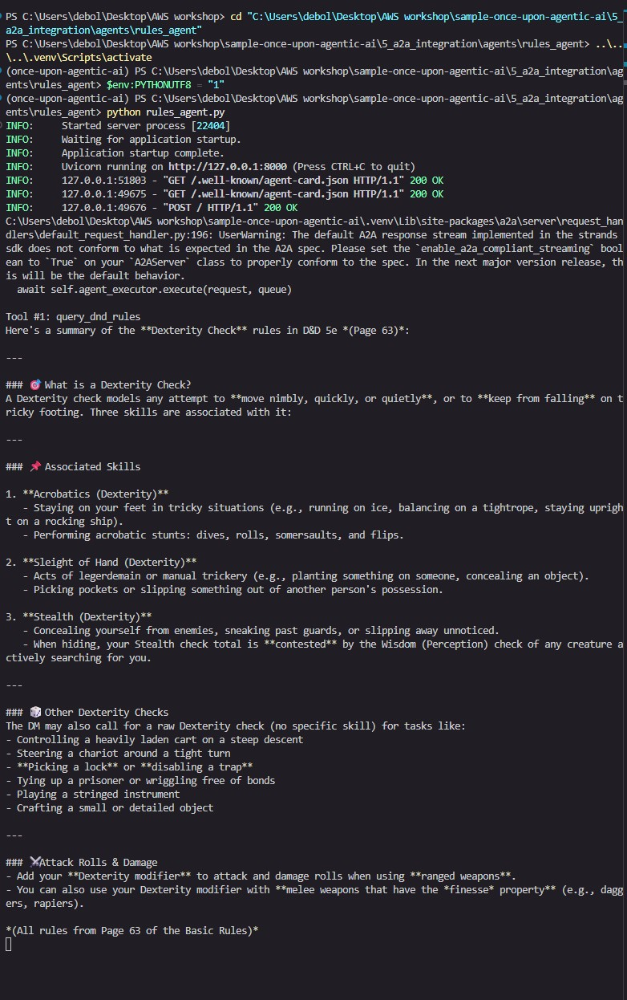

Character Agent on port 8001:

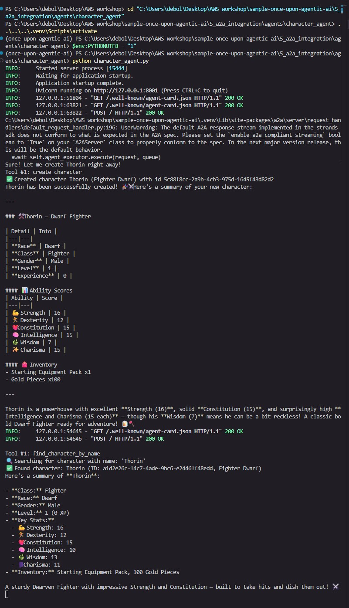

Dice server on port 8002, logging each `🎲 DICE ROLL`:

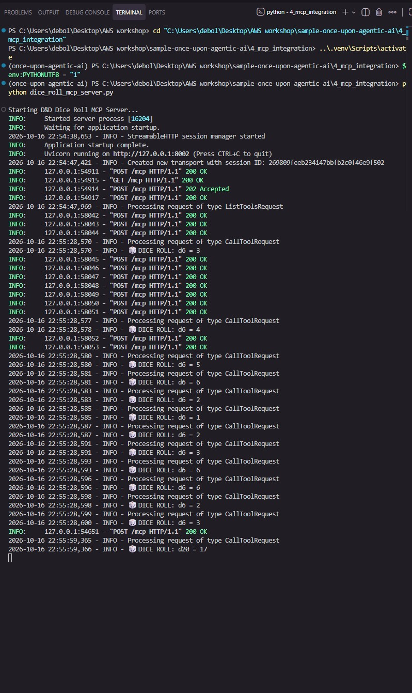

Game Master orchestrator on port 8009 — `a2a_client` discovery, `roll_dice` calls, and `StoryOutput` responses (shown across two captures):

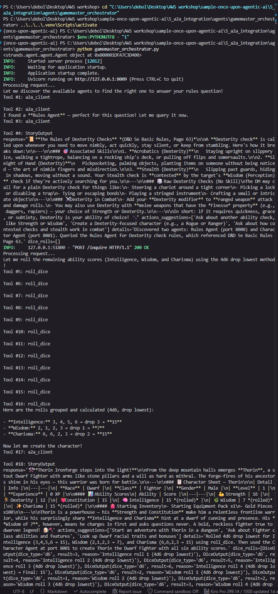

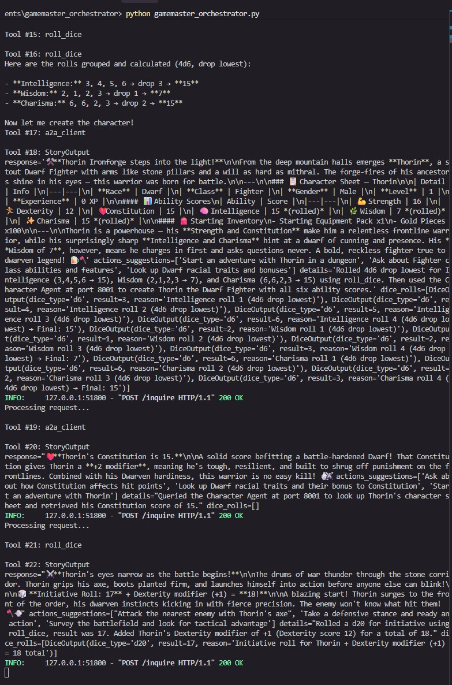

Test terminal — the `StoryOutput` JSON returned from `/inquire`:

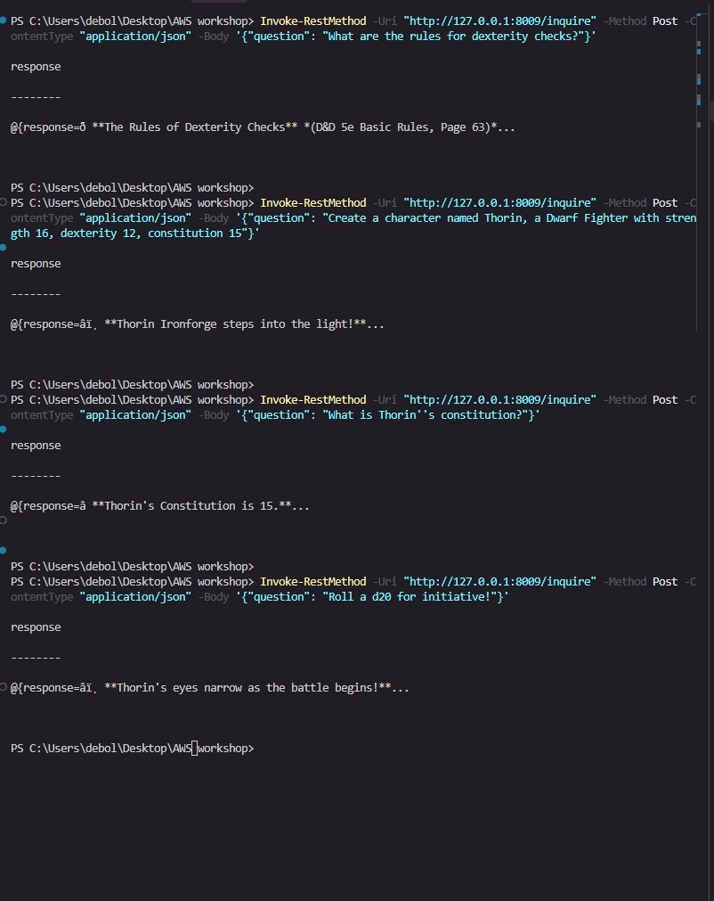

## Chapter 6 — Web Interface Testing

**Goal:** Play with the full system you built in a real browser. A hosted web page acts as a front end for the Game Master orchestrator, so you can create a character and interact with it through a UI instead of `curl`. There's no code to write in this chapter — it's end-to-end testing.

### Prerequisite — keep the services running

The web page talks to your local Game Master, so all four Chapter 5 services must be up first:

| Port | Service |
|------|---------|
| 8000 | Rules Agent |
| 8001 | Character Agent |
| 8002 | Dice server |
| 8009 | Game Master orchestrator |

(See the "Running all five terminals" section in Chapter 5 for the launch commands.)

### Connect the web interface

1. Open the hosted interface: [Once Upon an Agentic AI web UI](https://aws-samples.github.io/sample-once-upon-agentic-ai/).
2. Fill in your character: **name, gender, race, class**.
3. In **Server URL**, enter the URL from your Game Master terminal: `http://127.0.0.1:8009` (no trailing slash or path).
4. Click **Start / Generate**.

The page runs in your browser but reaches `http://127.0.0.1:8009` because that's localhost — browsers allow an HTTPS page to call a local address.

### Watch the terminal

While you play, the Game Master terminal shows how each request is handled — the same flow as the `curl` tests, now driven by the UI:

```
Processing request...
Tool #1: a2a_client
Tool #2: roll_dice
response='...' actions_suggestions=[...] details='...' dice_rolls=[...]
INFO:     127.0.0.1:53210 - "POST /inquire HTTP/1.1" 200 OK
```

### Customization ideas

- Change the Game Master's personality by editing its system prompt.
- Add new custom tools (Chapter 3 style) for other mechanics.
- Plug in additional MCP servers for new capabilities.

### Troubleshooting

- **"Connection Refused":** the Game Master isn't running on 8009, or a firewall is blocking it. Confirm the orchestrator terminal shows `Uvicorn running on http://127.0.0.1:8009`.
- **"Invalid Server URL":** the URL must be exactly `http://127.0.0.1:8009`, with no trailing space or path.
- **Slow responses:** check local resource usage and network stability; the model calls go out to Bedrock.

### Checkpoint

After Chapter 6 you should have:

- Connected the hosted web UI to your local Game Master
- Created and played a character through the browser
- Followed the agent's tool calls in the terminal as the UI drives it

Example run — the web interface playing against the local Game Master.

Character sheet and the Game Master's rendered rules lookup and character creation:

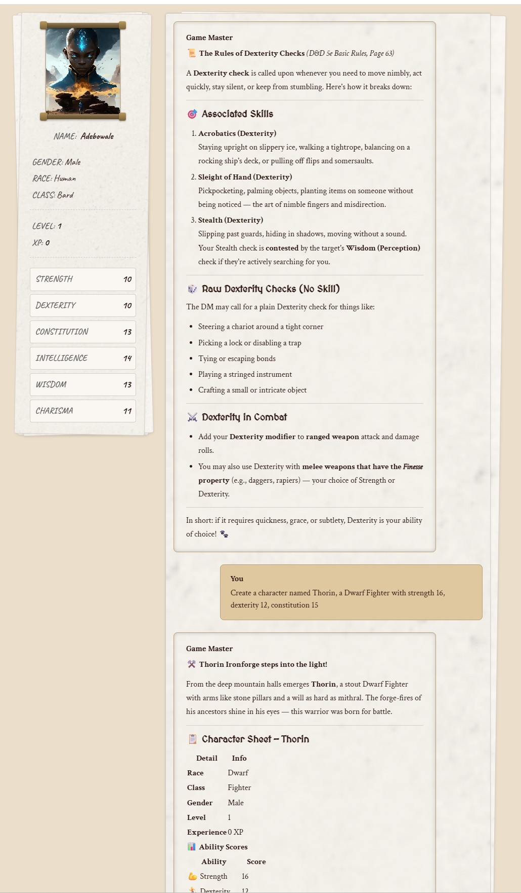

Gameplay — dice roll visualizations, a character lookup, and an initiative roll rendered from the `StoryOutput` data:

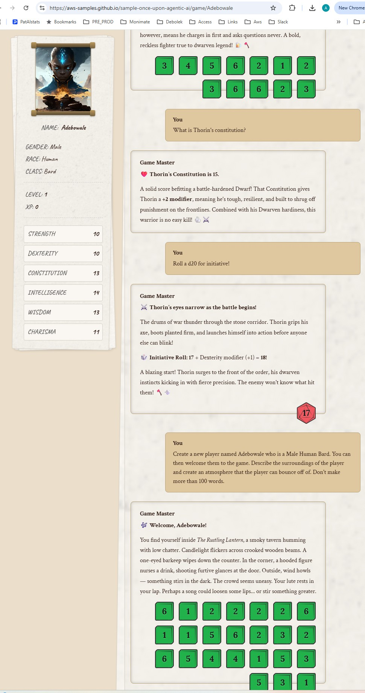

## Chapter 7 — The Enchanted Armour: Strands Harness

**Goal:** Rebuild the Chapter 5 orchestrator a different way. Chapters 1–5 assembled the Game Master piece by piece; `create_harness()` returns a fully assembled agent in one call — tuned system prompt, built-in tools, sessions, long-term memory, context management, and prompt caching all included. The API and web interface stay the same, so you can compare the two approaches directly.

Move into the Chapter 7 folder:

```bash
cd sample-once-upon-agentic-ai/7_strands_harness
```

The work happens in `gamemaster_harness.py`.

### SDK vs harness

- **Strands SDK** (`from strands import Agent`) — what Chapters 1–5 used; you assemble the agent loop yourself, tool by tool.
- **Strands harness** (`from strands_harness import create_harness`) — a pre-assembled agent built on that SDK. It returns a plain `Agent`, so everything you learned still applies and every default can be overridden.

Out of the box, `create_harness()` gives you a tuned system-prompt "contract," built-in tools (shell/read/write/edit/web), on-disk resumable sessions, long-term memory, automatic context management, and prompt caching — defaulting to Claude Opus 5 with reasoning.

### Before you start

Start the three services from Chapters 4–5 (dice server on 8002, Rules Agent on 8000, Character Agent on 8001). Stop the Chapter 5 orchestrator — the harness takes its place on port 8009, so the Chapter 6 web UI keeps working unchanged.

### The seven steps

The A2A client tool from Chapter 5 is already in the file. Only the Game Master around it changes:

```python
from strands_harness import create_harness          # Step 1 (import)

agent = create_harness(
    instructions=INSTRUCTIONS,                        # Step 1 — domain text, appended after the harness contract
    mcp_servers={"dice": {"url": "http://127.0.0.1:8002/mcp"}},  # Step 2 — the harness connects it; tool becomes dice_roll_dice
    tools=[a2a_client],                               # Step 3 — your own tools alongside the built-ins
    builtin_tools=[],                                 # Step 4 — a Game Master needs no shell/file/web access
    session={"id": "dnd-campaign"},                   # Step 5 — named, resumable session on disk
    structured_output_model=StoryOutput,              # Step 6 — passthrough to the SDK Agent (keeps the web UI contract)
)
```

- `mcp_servers` uses the standard `mcpServers` config shape — no `MCPClient`, no transport import. The key becomes a tool prefix (`dice_roll_dice`).
- `builtin_tools=[]` disables the coding-agent tools the harness ships with.
- `session={"id": ...}` persists the campaign under `.agent/sessions`; restarting with the same id resumes it.
- `structured_output_model` is not a `create_harness` parameter — it falls through the `**agent_kwargs` bag straight to the SDK `Agent`, exactly as in Chapter 5.

### Running all terminals (Windows)

Four service terminals plus one test terminal. Start them in order 1 → 2 → 3 → 4, waiting for each to print `Uvicorn running on http://127.0.0.1:800X` (the harness connects to the others, so it goes last).

**Terminal 1 — Dice server (port 8002)**
```powershell
cd "C:\Users\debol\Desktop\AWS workshop\sample-once-upon-agentic-ai\4_mcp_integration"
..\.venv\Scripts\activate
$env:PYTHONUTF8 = "1"
python dice_roll_mcp_server.py
```

**Terminal 2 — Rules Agent (port 8000)**
```powershell
cd "C:\Users\debol\Desktop\AWS workshop\sample-once-upon-agentic-ai\5_a2a_integration\agents\rules_agent"
..\..\..\.venv\Scripts\activate
$env:PYTHONUTF8 = "1"
python rules_agent.py
```

**Terminal 3 — Character Agent (port 8001)**
```powershell
cd "C:\Users\debol\Desktop\AWS workshop\sample-once-upon-agentic-ai\5_a2a_integration\agents\character_agent"
..\..\..\.venv\Scripts\activate
$env:PYTHONUTF8 = "1"
python character_agent.py
```

**Terminal 4 — Game Master harness (port 8009)**
```powershell
cd "C:\Users\debol\Desktop\AWS workshop\sample-once-upon-agentic-ai\7_strands_harness"
..\.venv\Scripts\activate
$env:PYTHONUTF8 = "1"
python gamemaster_harness.py
```

**Terminal 5 — tests** (no venv needed; use `Invoke-RestMethod` on Windows):
```powershell
Invoke-RestMethod -Uri "http://127.0.0.1:8009/inquire" -Method Post -ContentType "application/json" -Body '{"question": "Create a character named Thorin, a Dwarf Fighter. Roll his ability scores."}'
```

Then stop the harness in Terminal 4 (`Ctrl+C`), start it again, and run the follow-up to see the session resume:
```powershell
Invoke-RestMethod -Uri "http://127.0.0.1:8009/inquire" -Method Post -ContentType "application/json" -Body '{"question": "Where did we stop last time, and what is my character called?"}'
```

If a port is already in use, stop the stale process: `Get-NetTCPConnection -LocalPort 8009 -State Listen | Select-Object OwningProcess`, then `Stop-Process -Id <PID>`.

### Step 7: Run and compare

```bash
python gamemaster_harness.py
```

Create a character, stop the server, restart it, then ask it to recall the session — the `.agent/sessions/session/dnd-campaign/.../snapshots/snapshot_latest.json` file holds the whole conversation, and the harness reloads it on startup. Long-term memory lives in `.agent/memory`. Both folders are gitignored.

> **Model access:** the harness defaults to **Claude Opus 5 with reasoning**. If your account lacks Opus 5 access, you'll get an `AccessDeniedException` (`anthropic.claude-opus-5 is not available for this account`). Pass a model you can use instead — in this run we set `model="global.anthropic.claude-sonnet-4-6"` (the Chapter 1–5 Sonnet model). Opus 5 also reasons for ~40s per turn; `effort="low"` speeds it up.

### SDK (Ch. 5) vs harness (Ch. 7)

| | Chapter 5 (SDK) | Chapter 7 (harness) |
|---|---|---|
| Dice via MCP | `MCPClient(lambda: streamablehttp_client(...))` | `mcp_servers={"dice": {"url": ...}}` |
| Remote agents | `make_a2a_client(...)` | same |
| System prompt | written from scratch | harness contract + your `instructions` |
| Model | Claude Sonnet (default) | Claude Opus 5 w/ reasoning (default) |
| Sessions, memory, caching, context | none | on by default |
| Lines of agent code | ~20 | ~10 |

**When to use which:** reach for the harness when its defaults fit and you want a capable agent fast; drop to the SDK when you need a bespoke toolset, a custom loop, or multi-agent orchestration. They compose, since the harness returns a plain `Agent`.

### Checkpoint

After Chapter 7 you should understand:

- How Strands harness relates to the SDK from Chapters 1–5
- Rebuilding the Game Master with `create_harness` (instructions, `mcp_servers`, your tools, `builtin_tools`)
- Resuming a campaign across restarts with a named session
- When to pick the harness and when to stay on the SDK

Example run — the harness terminal shows capabilities you never wired by hand: `todo_write` planning, `dice_roll_dice` over MCP, parallel `a2a_client` calls, `search_memory`, and `StoryOutput`.

Character creation — `todo_write`, the 24 `dice_roll_dice` calls, and the parallel `a2a_client` calls:

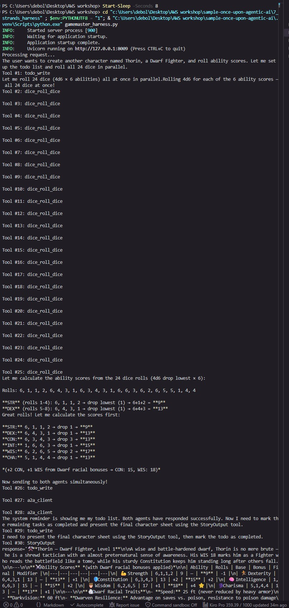

Session recall after restart — `search_memory` and `a2a_client`, returning a `StoryOutput` that identifies the character:

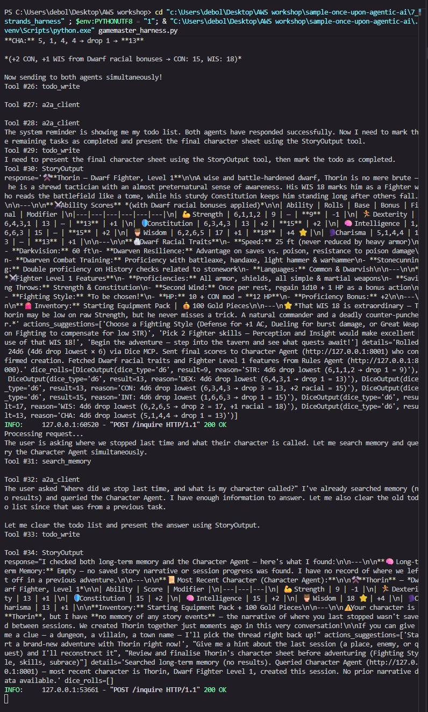

## Chapter Indexat the top of the card: this is what the orchestrator reads in Part 3 to decide which agent to ask. It is required, the server refuses to start without one. See the documentation  for an example of an agent with a name and a description.

Step 4: Create the A2A Server
1
# TODO: Step 4 - Create an A2AServer with the create_agent factory on port 8000

A2AServer wraps your factory in an HTTP server that speaks the A2A protocol: it serves the agent card and builds one agent per context_id through create_agent. See the documentation .

Step 5: Serve the Agent
1
# TODO: Step 5 - Start the A2A server

serve() starts the server and blocks until you stop it. It sits under if __name__ == "__main__": so that importing the module (the tests do) does not start a server.

Step 6: Launch the Rules Agent
Open a new terminal in the chapter folder (5_a2a_integration), activate the virtual environment (a new terminal does not keep the one from Chapter 0: source ../.venv/bin/activate) and start the agent from its folder:

1
2
cd agents/rules_agent
python rules_agent.py

You should see Uvicorn running on http://127.0.0.1:8000. Open http://127.0.0.1:8000/.well-known/agent-card.json  in your browser: this is the agent card, with the name and description you just wrote. Leave this terminal open, the orchestrator needs the agent in Part 4.

Part 2: Setting Up the Character Agent
The Character Agent manages character creation and lookup. It comes with three pre-built tools:

create_character: Creates new characters with stats
find_character_by_name: Looks up characters by name
list_all_characters: Lists all characters in the database
Configure the Character Agent
In agents/character_agent/character_agent.py, the factory create_agent already exists. Same six steps as for the Rules Agent, with this agent's tools and card.

Step 1: Add the Tools
1
# TODO: Step 1 - Add the create_character, find_character_by_name and list_all_characters tools to the agent

Three tools this time; the agent picks the right one from their docstrings.

Step 2: Add the Name
1
# TODO: Step 2 - Add the name "Character Agent" to the agent

First field of this agent's card, as in Part 1.

Step 3: Add the Description
1
# TODO: Step 3 - Add the description "D&D character management: creates characters (ability scores rolled 4d6 drop lowest), stores them, finds and lists them." to the agent

Second field of the card, what the orchestrator will read to pick this agent.

Step 4: Create the A2A Server
1
# TODO: Step 4 - Create an A2AServer with the create_agent factory on port 8001

Port 8001: each agent needs its own port.

Step 5: Serve the Agent
1
# TODO: Step 5 - Start the A2A server

Same as in Part 1.

Step 6: Launch the Character Agent
Open a second terminal (the Rules Agent keeps running in the first one), activate the virtual environment again and start the agent:

1
2
cd agents/character_agent
python character_agent.py

You should see Uvicorn running on http://127.0.0.1:8001, and its agent card at http://127.0.0.1:8001/.well-known/agent-card.json . Leave this terminal open too.

Part 3: Setting Up the Game Master Orchestrator
The Game Master Orchestrator coordinates all agents and serves as the main API endpoint. It integrates:

The Rules Agent (via A2A)
The Character Agent (via A2A)
The dice service (the MCP server from Chapter 4)
Configure the Game Master Agent
Step 1: Create MCP Client for Dice Rolling
1
# TODO: Step 1 - Create a streamable http MCPClient connecting to "http://localhost:8002/mcp"

Same client as in Chapter 4: an MCPClient built from a lambda that returns streamablehttp_client("http://localhost:8002/mcp"). See the streamable HTTP transport  documentation; as before, the client goes straight into tools=[...], no with block (managed integration ).

Step 2: Create the A2A Client Tool
1
# TODO: Step 2 - Create the A2A client tool with make_a2a_client and the allowed agent endpoints

make_a2a_client builds a single tool, a2a_client, that the Game Master uses to talk to remote agents: with operation="discover" it fetches an agent's card (name, description, skills), and with operation="send_message" it sends a request to that agent's endpoint. Pass it allowed_endpoints, the list of agent URLs it may reach ("http://127.0.0.1:8000" for the Rules Agent, "http://127.0.0.1:8001" for the Character Agent): any other endpoint is rejected before a connection is even made. See the a2a_client tool documentation .

Step 3: Add the Tools
1
# TODO: Step 3 - Add the mcp_client and a2a_client tools to the agent

The Game Master gets two tools: mcp_client, which brings in roll_dice from the dice server, and a2a_client, which lets it discover and message the Rules Agent and the Character Agent. Pass the MCP client itself, as in Chapter 4: Strands lists its tools when the agent starts. See give your agent tools  in the documentation.

Step 4: Force Structured Output
By default, an agent replies with free-form text. Structured output makes the model return a typed object that matches a schema you define as a Pydantic model; Strands validates it and hands it back as clean JSON. See the structured output documentation .

1
# TODO: Step 4 - Force the response to use the StoryOutput model

We have coded StoryOutput for you, a little further up in the file: the schema of one Game Master turn, with response (the narration), actions_suggestions (what the player could do next), details (which tools and agents were used) and dice_rolls (each roll with its type, result and reason). Here is an example:

1
2
3
4
5
6
{
  "response": "The die tumbles across the table and lands on a 13! You are quick off the mark as the chaos of combat erupts around you.",
  "actions_suggestions": ["Draw your weapon", "Look for cover", "Shout a warning to your allies"],
  "details": "roll_dice (d20) through the dice server",
  "dice_rolls": [{"dice_type": "d20", "result": 13, "reason": "initiative roll"}]
}

We need this shape because the web interface you will play with in Chapter 6 renders those fields separately: parsing free-form prose would be fragile, whereas a guaranteed JSON shape keeps the UI reliable.

Step 5: Launch the Game Master
The Game Master rolls its dice through the MCP server from Chapter 4, so that server has to run too. If it is still running from Chapter 4, skip this. Otherwise open a third terminal in the chapter folder, activate the virtual environment and start it:

1
2
cd ../4_mcp_integration
python dice_roll_mcp_server.py

Then open a fourth terminal for the Game Master itself:

1
2
cd agents/gamemaster_orchestrator
python gamemaster_orchestrator.py

You should see Uvicorn running on http://127.0.0.1:8009. Four terminals are now running: the Rules Agent, the Character Agent, the dice server and the Game Master.

Part 4: Test the System
At this point four terminals should be running:

Terminal	Process	Endpoint
1	Rules Agent, python rules_agent.py	http://127.0.0.1:8000 
2	Character Agent, python character_agent.py	http://127.0.0.1:8001 
3	Dice server (Chapter 4), python dice_roll_mcp_server.py	http://127.0.0.1:8002/mcp 
4	Game Master, python gamemaster_orchestrator.py	http://127.0.0.1:8009 
If one is missing, go back to the launch step of its part.

The Game Master is a FastAPI application listening on port 8009. Each curl command below sends a POST request to its /inquire endpoint with a JSON body holding your question, exactly what a web page or any other client would do. While the request runs, the four terminals show how the Game Master treats it: which agent it asks over A2A, when it rolls the dice over MCP, and what each of them answers. Open a fifth terminal for the commands themselves (no virtual environment needed, curl is a system command) and run them there (or, if you have a REST client, use the test/test.http file we prepared for these tests):

1
2
3
4
# Query D&D rules
curl -X POST http://0.0.0.0:8009/inquire \
  -H "Content-Type: application/json" \
  -d '{"question": "What are the rules for dexterity checks?"}'

1
2
3
4
# Create a new character
curl -X POST http://0.0.0.0:8009/inquire \
  -H "Content-Type: application/json" \
  -d '{"question": "Create a character named Thorin, a Dwarf Fighter with strength 16, dexterity 12, constitution 15"}'

1
2
3
4
# Look up a character
curl -X POST http://0.0.0.0:8009/inquire \
  -H "Content-Type: application/json" \
  -d '{"question": "What is Thorin'\''s constitution?"}'

1
2
3
4
# Roll for initiative
curl -X POST http://0.0.0.0:8009/inquire \
  -H "Content-Type: application/json" \
  -d '{"question": "Roll a d20 for initiative!"}'

Watch the four terminals while a request runs. In the Game Master terminal the tool calls appear in order: a2a_client discovering the agent cards, then send_message to the Rules Agent or the Character Agent, or roll_dice for the dice. The agent you asked logs the question in its own terminal, and the dice server prints a 🎲 DICE ROLL line for every roll. The answer you get back is JSON shaped like StoryOutput: response, actions_suggestions, details and dice_rolls.
> Also note that a Windows `.venv` and a WSL `.venv` can't coexist in the same folder — each `uv sync` replaces the other. If you switch between them, delete `.venv` and run `uv sync` again for the platform you're using.

### Checkpoint

After Chapter 3 you should understand:

- How to turn a Python function into a tool with the `@tool` decorator
- How a docstring (summary + `Args:` + `Returns:`) shapes what the model knows about the tool
- How to attach a custom tool to an agent via `tools=[...]`

Example run — Lady Luck makes 16 `roll_dice` calls (4d6 per ability) and reports the scores:

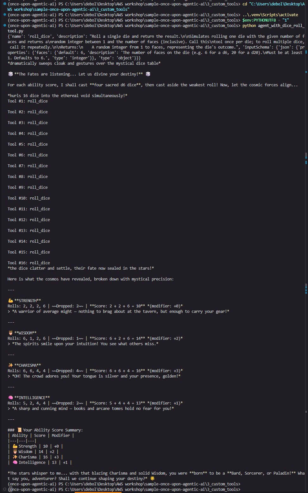

## Chapter 4 — MCP Integration (Model Context Protocol)

**Goal:** Serve the `roll_dice` tool over the Model Context Protocol. You build a standalone MCP server that exposes the dice service, then connect the Game Master to it as an MCP client. The tool is identical to Chapter 3 — only *where it runs* changes: instead of living inside the agent's process, it now runs in its own server that any number of clients can share.

**What is MCP?** The [Model Context Protocol](https://modelcontextprotocol.io/) is an open standard for how an AI application talks to external tools and data. An MCP server exposes tools (name, description, JSON schema — the same shape as `tool_spec`) over a transport: `stdio` for a local child process, or streamable HTTP for an independent networked process. The agent acts as an MCP client: it connects, lists the tools, and calls them, with no custom code per server.

Move into the Chapter 4 folder:

```bash
cd sample-once-upon-agentic-ai/4_mcp_integration
```

You create two components: a server (`dice_roll_mcp_server.py`) and a client (`gamemaster_mcp_client.py`).

### Part 1 — The MCP server (`dice_roll_mcp_server.py`)

The `roll_dice` function is unchanged from Chapter 3; only the way it's served changes — from `@tool` to `@mcp.tool()`.

- **Step 1 — Create the server:** import `FastMCP` and make an instance on port 8002. It needs no name; clients only ever see the tools, not the server.
  ```python
  from mcp.server import FastMCP

  mcp = FastMCP(port=8002)
  ```
- **Step 2 — Expose the tool:** decorate `roll_dice` with `@mcp.tool()` (note the parentheses — it's called). FastMCP builds the same spec from the function name, docstring, and typed parameters, then serves it over the network.
  ```python
  @mcp.tool()
  def roll_dice(faces: int = 6) -> int:
      ...
  ```
- **Step 3 — Choose the transport:** run with streamable HTTP so the server is an independent process at `http://localhost:8002/mcp` that any client can reach.
  ```python
  if __name__ == "__main__":
      print("Starting D&D Dice Roll MCP Server...")
      mcp.run(transport="streamable-http")
  ```
- **Step 4 — Launch it:**
  ```bash
  python dice_roll_mcp_server.py
  ```
  You should see `Starting D&D Dice Roll MCP Server...` and `Uvicorn running on http://127.0.0.1:8002`. **Leave this terminal open** — the server must stay up while the client talks to it.

### Part 2 — The MCP client (`gamemaster_mcp_client.py`)

- **Step 1 — Create the client:** import `MCPClient` and `streamablehttp_client`, then connect to the dice server with a lambda.
  ```python
  from strands.tools.mcp import MCPClient
  from mcp.client.streamable_http import streamablehttp_client

  mcp_dice_client = MCPClient(lambda: streamablehttp_client("http://localhost:8002/mcp"))
  ```
- **Step 2 — Attach it to the agent:** pass the client itself into `tools=[...]`. No `with` block is needed — `MCPClient` is a tool provider, so Strands opens the connection on first use (to list tools) and closes it when the agent shuts down.
  ```python
  gamemaster = Agent(
      system_prompt="""You are Lady Luck, ...""",
      tools=[mcp_dice_client],
  )
  ```
- **Step 3 — Launch it (second terminal):** keep the server running in the first terminal, then from the same folder:
  ```bash
  python gamemaster_mcp_client.py
  ```
  The client connects, Strands fetches the tool list and gets `roll_dice`, and Lady Luck rolls four ability scores (16 rolls). The narration prints in the client terminal, while every roll shows up in the **server** terminal as a `🎲 DICE ROLL: d6 = …` line — proof the dice now live in a separate process.

> **Running two processes:** this chapter needs the server and client running at the same time, in two terminals. On Windows, add `$env:PYTHONUTF8 = "1"` in each terminal so the emoji print cleanly. If you continue to Chapter 5, keep the server terminal running — the Game Master reuses this same dice server.

### Checkpoint

After Chapter 4 you should understand:

- How to expose a tool as an MCP server with `FastMCP` and `@mcp.tool()`
- How to connect an MCP client to that server with `MCPClient` + `streamablehttp_client`
- How Strands integrates an MCP tool provider into an agent via `tools=[...]`

Example run — the two terminals side by side show the MCP split in action.

Client terminal — Lady Luck narrates and makes 16 `roll_dice` calls, then reports the scores:

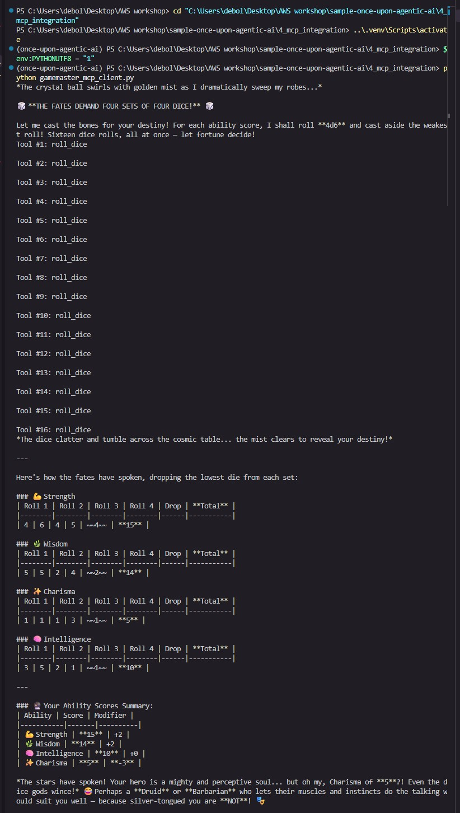

Server terminal — the same 16 rolls arrive as `CallToolRequest`s and log `🎲 DICE ROLL: d6 = …`, proving the dice run in a separate process:

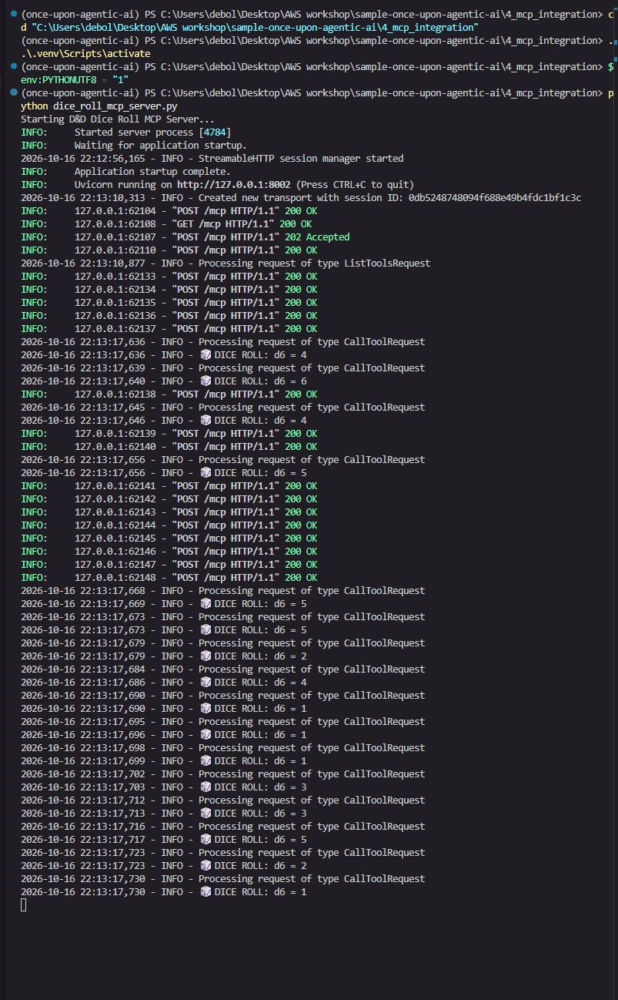

## Chapter Index

| # | Chapter | What it covers |
|---|---------|----------------|
| 0 | Setting Up Your Environment | Clone the repo, install `uv` and Python, sync dependencies, activate the venv |
| 1 | Creating Your First Agent | Build a Game Master agent with a system prompt and debug logging |
| 2 | Vended Tools: The Adventurer's Arsenal | Add the `http_request` vended tool so the agent can call a real D&D API |
| 3 | Creating Custom Tools | Build a custom `roll_dice` tool with the `@tool` decorator and a guiding docstring |
| 4 | MCP Integration | Serve `roll_dice` from a FastMCP server and connect the agent as an MCP client |
| 5 | Agent-to-Agent Communication | Expose Rules and Character agents over A2A and orchestrate them with a Game Master |
| 6 | Web Interface Testing | Connect the hosted web UI to the local Game Master and play through the browser |
| 7 | The Enchanted Armour: Strands Harness | Rebuild the orchestrator with `create_harness` — sessions, memory, and defaults in one call |

Add new rows here as you work through later chapters.

## Links

- [Workshop lab](https://catalog.us-east-1.prod.workshops.aws/workshops/e1493217-4bc7-42f4-87d9-e231acd743bc/en-US)
- [Sample repository](https://github.com/aws-samples/sample-once-upon-agentic-ai)
- [Strands SDK](https://github.com/strands-agents)
- [uv documentation](https://docs.astral.sh/uv/)
